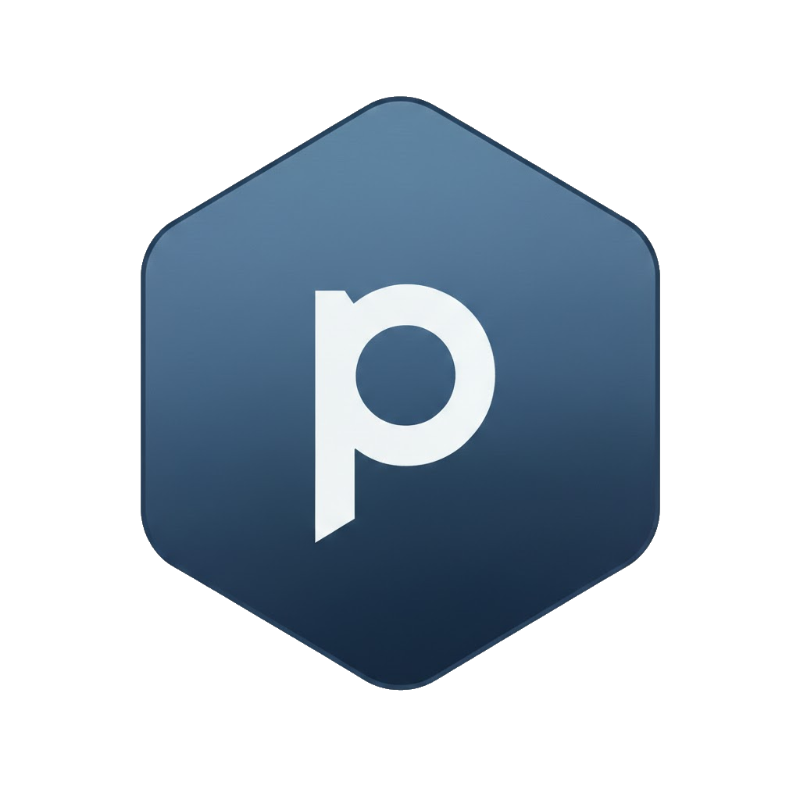

# PolyPrompt

[](https://www.nuget.org/packages/PolyPrompt/)
[](https://www.nuget.org/packages/PolyPrompt/)
[](LICENSE.md)

One .NET client per LLM provider, with the same methods on every client: chat, tool calling, streaming, text generation, embeddings, reranking, classification, decision models, and model listing.

- **Providers:** OpenAI, OpenAI-compatible servers (vLLM, LM Studio, Ollama `/v1`, gateways), Azure OpenAI, xAI Grok, Anthropic, Google Gemini, Vertex AI, AWS Bedrock, Ollama, Ollama Cloud, Cohere, VoyageAI, Hugging Face TEI, and TypeSafe.
- **Agent harnesses:** Claude Code, Codex, Gemini CLI, Cursor CLI, Mux, Pi, and OpenCode, run as local child processes. See [Agent harnesses](#agent-harnesses).
- **No provider SDKs.** Targets .NET 8 and .NET 10, and is Native AOT and trimming compatible.

> **Upgrading from 3.x?** See [MIGRATION_V3_TO_V4.md](MIGRATION_V3_TO_V4.md). What changed in 4.0 is in the [CHANGELOG](CHANGELOG.md).

## Installation

```bash
dotnet add package PolyPrompt
```

## Quick start

```csharp
using PolyPrompt.Clients;
using PolyPrompt.Models;

using OpenAiClient openai = new OpenAiClient(Environment.GetEnvironmentVariable("OPENAI_API_KEY")!);

ChatResponse reply = await openai.ChatAsync("Explain dependency injection in one paragraph.");
Console.WriteLine(reply.Text);

EmbeddingResponse vector = await openai.EmbedAsync("some text");
```

## Creating a client

Hosted APIs take an API key:

```csharp
using PolyPrompt.Clients;

string key = "your-key";

using OpenAiClient openai = new OpenAiClient(key);
using AnthropicClient claude = new AnthropicClient(key);
using GeminiClient gemini = new GeminiClient(key);
using XAiClient grok = new XAiClient(key);
using CohereClient cohere = new CohereClient(key);
using VoyageAiClient voyage = new VoyageAiClient(key);
using TypeSafeClient jev = new TypeSafeClient(key);

using OllamaCloudClient ollamaCloud = new OllamaCloudClient(key);
ollamaCloud.Defaults.Completion.Model = "gpt-oss:120b";   // no default model
```

Servers you run take an endpoint (and an optional key):

```csharp
using PolyPrompt.Clients;

using OllamaClient ollama = new OllamaClient();             // http://localhost:11434
using TeiClient tei = new TeiClient("http://localhost:8080");

using OpenAiCompatibleClient vllm = new OpenAiCompatibleClient("http://localhost:8000/v1");
vllm.Defaults.Completion.Model = "qwen3-8b";                // no default model
```

Cloud platforms take a region or resource and a credential:

```csharp
using PolyPrompt.Auth;
using PolyPrompt.Clients;

using AzureOpenAiClient azure = new AzureOpenAiClient("https://my-resource.openai.azure.com", "azure-key");
azure.Defaults.Completion.Model = "my-gpt-deployment";

using VertexAiClient vertex = new VertexAiClient("my-project", "us-central1", new AdcCredential());

using BedrockClient bedrock = new BedrockClient("us-east-1", new EnvironmentAwsCredential("us-east-1"));
bedrock.Defaults.Completion.Model = "anthropic.claude-sonnet-5-5";
```

Every constructor signature, and how each provider authenticates, is in [PROVIDERS.md](PROVIDERS.md).

## Capability matrix

Every client has every method, but not every provider supports every capability. Call `client.Supports(Capability.Embed)` to check. An unsupported call throws `CapabilityNotSupportedException` before any request is sent.

<!-- capability-matrix:start -->
| Client | Chat | ToolChat | Generate | Embed | SparseEmbed | Rerank | Classify | Decide | Models |
|---|---|---|---|---|---|---|---|---|---|
| `OpenAiClient` | ✅ | ✅ | ✅ | ✅ | | | | | ✅ |
| `OpenAiCompatibleClient` | ✅ | ✅ | ✅ | ✅ | | | | | ✅ |
| `AzureOpenAiClient` | ✅ | ✅ | ✅ | ✅ | | | | | ✅ |
| `XAiClient` | ✅ | ✅ | ✅ | | | | | | ✅ |
| `AnthropicClient` | ✅ | ✅ | ✅ | | | | | | ✅ |
| `GeminiClient` | ✅ | ✅ | ✅ | ✅ | | | | | ✅ |
| `VertexAiClient` | ✅ | ✅ | ✅ | ✅ | | | | | |
| `BedrockClient` | ✅ | ✅ | ✅ | ✅ | | ✅ | | | ✅ |
| `OllamaClient` | ✅ | ✅ | ✅ | ✅ | | | | | ✅ |
| `OllamaCloudClient` | ✅ | ✅ | ✅ | ✅ | | | | | ✅ |
| `CohereClient` | ✅ | ✅ | ✅ | ✅ | | ✅ | ✅ | | ✅ |
| `VoyageAiClient` | | | | ✅ | | ✅ | | | |
| `TeiClient` | | | | ✅ | ✅ | ✅ | ✅ | | ✅ |
| `TypeSafeClient` | | | | | | | | ✅ | |
<!-- capability-matrix:end -->

| Capability | Methods |
|---|---|
| `Chat` | `ChatAsync`, `ChatStreamingAsync` |
| `ToolChat` | `ToolChatAsync`, `ToolChatStreamingAsync` |
| `Generate` | `GenerateAsync`, `GenerateStreamingAsync` |
| `Embed` | `EmbedAsync` |
| `SparseEmbed` | `EmbedSparseAsync` |
| `Rerank` | `RerankAsync` |
| `Classify` | `ClassifyAsync` |
| `Decide` | `DecideAsync` |
| `Models` | `ListModelsAsync`, `ModelExistsAsync`, `GetModelInformationAsync` |

`ValidateConnectivityAsync` is on every client. A specific model can still lack a feature the provider supports, such as tool calling on a small Ollama model.

## Which OpenAI client?

| You are calling | Use |
|---|---|
| OpenAI (`api.openai.com`) | `OpenAiClient` |
| Azure OpenAI | `AzureOpenAiClient` |
| vLLM, Ollama `/v1`, LM Studio, OpenRouter, gateways | `OpenAiCompatibleClient` |

`OpenAiClient` and `AzureOpenAiClient` use the Responses API. `OpenAiCompatibleClient` uses Chat Completions, which is what most other servers implement. If `OpenAiClient` gets a 404 from a server without `/responses`, the error tells you to switch. Responses-specific features (stored responses, native events, hosted tools) are covered in [PROVIDERS.md](PROVIDERS.md#responses-api-openai-azure-openai-xai).

## The basics

### Models and options

Set defaults once on the client, and override them per call. Each provider has its own options type for provider-specific settings:

```csharp
using PolyPrompt.Clients;
using PolyPrompt.Models;
using PolyPrompt.Options;

using OllamaClient ollama = new OllamaClient();
ollama.Defaults.Completion.Model = "gpt-oss:20b";
ollama.Defaults.Completion.SystemPrompt = "Be concise.";
ollama.Defaults.Embedding.Model = "all-minilm";

// Temperature for this call only.
ChatResponse reply = await ollama.ChatAsync("Explain dependency injection.", new CompletionOptions { Temperature = 0.9 });

// Ollama-specific options, and a different model for this call only.
ChatResponse other = await ollama.ChatAsync("Hi", new OllamaCompletionOptions { Model = "gemma3:4b", TopK = 20 });
```

A per-call value wins over `Defaults`, and `Defaults` wins over the provider's own default. Passing another provider's options type (say, `AnthropicCompletionOptions` to an `OpenAiClient`) throws `ArgumentException`.

### Errors

- **HTTP failures don't throw.** Check `response.Success`, then `StatusCode` and `Error`.
- **Bad arguments throw** before any request: null inputs, empty lists, or a call with no model set.
- **Cancellation and timeouts** throw `OperationCanceledException`.

```csharp
using PolyPrompt.Clients;
using PolyPrompt.Models;

using AnthropicClient claude = new AnthropicClient(Environment.GetEnvironmentVariable("ANTHROPIC_API_KEY")!);

ChatResponse response = await claude.ChatAsync("Review this: var x = list.Count() > 0;");
if (response.Success) Console.WriteLine(response.Text);
else Console.WriteLine(response.StatusCode + ": " + response.Error);
```

### Shared settings

`ClientOptions` sets logging, timeouts, call recording, and the `HttpClient`. Clients can share one `HttpClient`, because credentials are attached per request:

```csharp
using PolyPrompt.Clients;
using PolyPrompt.Models;

using HttpClient shared = new HttpClient();
ClientOptions options = new ClientOptions
{
    HttpClient = shared,       // never disposed by the client
    TimeoutMs = 60000,
    CallDetailCapture = CallDetailCapture.Full,
    Logging = new SyslogLogging.LoggingModule(),
};

using AnthropicClient claude = new AnthropicClient("sk-ant-...", options: options);
using GeminiClient gemini = new GeminiClient("AIza...", options: options);
```

### Provider-agnostic code

Every provider client derives from `ProviderClientBase`:

```csharp
using PolyPrompt.Clients;
using PolyPrompt.Models;

static async Task<string?> AskAsync(ProviderClientBase client, string question)
{
    if (!client.Supports(Capability.Chat)) return null;
    ChatResponse response = await client.ChatAsync(question);
    return response.Success ? response.Text : response.Error;
}

using OllamaClient local = new OllamaClient();
Console.WriteLine(await AskAsync(local, "Hello"));
```

## Examples

### Streaming

```csharp
using PolyPrompt.Clients;
using PolyPrompt.Models;

using OllamaClient ollama = new OllamaClient();
ollama.Defaults.Completion.Model = "gpt-oss:20b";

ChatStreamingResponse stream = await ollama.ChatStreamingAsync("Write a haiku about compilers.");
await foreach (ChatStreamingChunk chunk in stream.Chunks)
{
    if (chunk.Text != null) Console.Write(chunk.Text);
}

if (stream.State != StreamingState.Completed) Console.WriteLine("Stream ended: " + stream.StreamError);
```

Read the stream to the end, and check `State == StreamingState.Completed` before trusting the result. [STREAMING.md](STREAMING.md) covers the details.

### Tool calling

Your code runs the tools. Append the model's turn with `ToAssistantMessage()`, add one result per tool call, and call again:

```csharp
using PolyPrompt.Clients;
using PolyPrompt.Models;

using GeminiClient gemini = new GeminiClient(Environment.GetEnvironmentVariable("GEMINI_API_KEY")!);

ToolChatRequest request = new ToolChatRequest
{
    Messages = { ChatMessage.User("What's the weather in Seattle and Tokyo?") },
    Tools = { ToolDefinition.Function("get_weather", "Get the weather.", new Dictionary<string, object> { { "type", "object" } }) },
};

ToolChatResponse turn = await gemini.ToolChatAsync(request);
while (turn.Success && turn.ToolCalls.Count > 0)
{
    request.Messages.Add(turn.ToAssistantMessage());
    foreach (ToolCall call in turn.ToolCalls)
        request.Messages.Add(ChatMessage.ToolResult(call.Id, call.Name, "{\"temperature\":72}"));
    turn = await gemini.ToolChatAsync(request);
}

Console.WriteLine(turn.Text);
```

Add the message from `ToAssistantMessage()` as is. It carries provider state such as encrypted reasoning and Gemini thought signatures, which some providers require on the next turn.

### Reasoning effort

One setting works across providers. Each provider maps it to its nearest supported value:

```csharp
using PolyPrompt.Clients;
using PolyPrompt.Models;
using PolyPrompt.Options;

using AnthropicClient claude = new AnthropicClient("sk-ant-...");
claude.Defaults.Completion.ReasoningEffort = ReasoningEffort.High;

ChatResponse quick = await claude.ChatAsync("Rate 0 to 10.", new CompletionOptions { ReasoningEffort = ReasoningEffort.None });
Console.WriteLine(quick.Reasoning + " / sent: " + quick.AppliedReasoningEffort);
```

The levels are `None`, `Minimal`, `Low`, `Medium`, `High`, `XHigh`, and `Max`. See [how each provider maps them](PROVIDERS.md#reasoning-effort).

### Embeddings, reranking, and classification

```csharp
using PolyPrompt.Clients;
using PolyPrompt.Models;
using PolyPrompt.Options;

using CohereClient cohere = new CohereClient("co-...");

EmbeddingResponse vectors = await cohere.EmbedAsync(new List<string> { "alpha", "beta" });

RerankResponse ranked = await cohere.RerankAsync("capital of France",
    new List<string> { "Berlin is in Germany.", "Paris is in France." },
    new RerankOptions { TopN = 1, ReturnDocuments = true });

Console.WriteLine(vectors.Embeddings.Count + " vectors, best match: " + ranked.Results[0].Document);
```

Rerank results are sorted by score on every provider. `TeiClient` also supports sparse embeddings with `EmbedSparseAsync`.

### Decision models

A decision model reads a state and answers typed questions with calibrated probabilities, without generating text:

```csharp
using PolyPrompt.Clients;
using PolyPrompt.Models;

using TypeSafeClient jev = new TypeSafeClient("ts-...");

DecisionRequest request = new DecisionRequest
{
    State = "My order arrived broken and I want my money back today.",
    Questions =
    {
        DecisionQuestion.Choice("intent", "What does the customer want?",
            DecisionOption.Of("refund"), DecisionOption.Of("billing"), DecisionOption.Of("other")),
        DecisionQuestion.Binary("urgent", "Does the customer need a response today?"),
    }
};

DecisionResponse response = await jev.DecideAsync(request);
if (response.Success) Console.WriteLine(response.Choice("intent").Value + ", urgent p=" + response.Binary("urgent").Probability);
```

### Models and connectivity

```csharp
using PolyPrompt.Clients;
using PolyPrompt.Models;

using OllamaClient ollama = new OllamaClient();

bool reachable = await ollama.ValidateConnectivityAsync();
await foreach (ModelInformation model in ollama.ListModelsAsync()) Console.WriteLine(model.Name);
bool exists = await ollama.ModelExistsAsync("gemma3");
```

## Agent harnesses

PolyPrompt can also drive local coding-agent CLIs. A harness runs its own tool loop, so you send a prompt and get back the result:

```csharp
using PolyPrompt.Clients;
using PolyPrompt.Models;

using CodexClient codex = new CodexClient { WorkingDirectory = "/path/to/repo" };

CliAgentResult result = await codex.RunAsync(new CliAgentRequest("Summarize what this repository does."));
Console.WriteLine(result.Success ? result.Text : result.FailureKind + ": " + result.Error);
```

Sign in with each CLI first; PolyPrompt never takes a harness API key. Harnesses run in `Restricted` permission mode (read-only tools) unless you choose otherwise. Setup, streaming, permission modes, and the exact flags passed are in [HARNESSES.md](HARNESSES.md).

## For coding agents

A compact, exact reference. Read the [capability matrix](#capability-matrix) and [Which OpenAI client?](#which-openai-client) too.

- **Construct one client per provider:** `new OpenAiClient(key)`, `new OpenAiCompatibleClient(endpoint, key?)`, `new AzureOpenAiClient(endpoint, key | ICredentialProvider)`, `new XAiClient(key)`, `new AnthropicClient(key)`, `new GeminiClient(key)`, `new VertexAiClient(project, region, credential)`, `new BedrockClient(region, awsCredential)`, `new OllamaClient(endpoint?)`, `new OllamaCloudClient(key)`, `new CohereClient(key)`, `new VoyageAiClient(key)`, `new TeiClient(endpoint)`, `new TypeSafeClient(key)`. Optional last arguments: `endpoint`, then `ClientOptions`. Dispose clients.
- **Operations** (all on `ProviderClientBase`): `ChatAsync(prompt, options?)`, `ChatStreamingAsync`, `ToolChatAsync(ToolChatRequest)`, `ToolChatStreamingAsync`, `GenerateAsync`, `GenerateStreamingAsync`, `EmbedAsync(string | List<string>, options?)`, `EmbedSparseAsync`, `RerankAsync(query, documents, options?)`, `ClassifyAsync`, `DecideAsync(DecisionRequest | List<DecisionRequest>)`, `ListModelsAsync`, `ModelExistsAsync`, `GetModelInformationAsync`, `ValidateConnectivityAsync`.
- **Capability rule:** call `client.Supports(Capability.X)` before an operation you are not sure of; otherwise it throws `CapabilityNotSupportedException` synchronously.
- **Models:** set `client.Defaults.Completion.Model` (or `.Embedding`, `.Rerank`, `.Classification`, `.Decision`, `.SparseEmbedding`), or pass `Model` in the per-call options. There is no `client.Model`. See [Default models](#default-models).
- **Options rule:** pass the base options type (`CompletionOptions`, `EmbeddingOptions`, ...) or the client's own type (`OpenAiCompletionOptions` for `OpenAiClient`/`AzureOpenAiClient`, `OpenAiCompatibleCompletionOptions` for `OpenAiCompatibleClient`, `GeminiCompletionOptions` for Gemini and Vertex, `<Provider>CompletionOptions` otherwise). Another provider's type throws `ArgumentException`.
- **Errors:** HTTP failures return `Success = false` with `StatusCode` and `Error`; they do not throw. Streams: enumerate fully, then check `State == StreamingState.Completed`.
- **Continuation state:** after a tool-chat turn, append `response.ToAssistantMessage()` unchanged, then one `ChatMessage.ToolResult(call.Id, call.Name, result)` per call. `ProviderState` carries reasoning and signatures.
- **Results:** `Text`, `Reasoning`, `ToolCalls`, `Usage`, `FinishReason`, `Citations` (never null), `RawResponse`, `AppliedReasoningEffort`.
- **Details:** [PROVIDERS.md](PROVIDERS.md) (per-provider behavior), [HARNESSES.md](HARNESSES.md), [STREAMING.md](STREAMING.md).

## Default models

"none" means you must set the model yourself, or the call throws `InvalidOperationException`.

<!-- default-models:start -->
| Client | Section | Default model |
|---|---|---|
| `OpenAiClient` | Completion | `gpt-6.1-sol` |
| `OpenAiClient` | Embedding | `text-embedding-3-small` |
| `OpenAiCompatibleClient` | Completion | none |
| `OpenAiCompatibleClient` | Embedding | none |
| `AzureOpenAiClient` | Completion | none |
| `AzureOpenAiClient` | Embedding | none |
| `XAiClient` | Completion | `grok-4.7` |
| `AnthropicClient` | Completion | `claude-sonnet-5-5` |
| `GeminiClient` | Completion | `gemini-3.8-flash` |
| `GeminiClient` | Embedding | `gemini-embedding-001` |
| `VertexAiClient` | Completion | `gemini-3.8-flash` |
| `VertexAiClient` | Embedding | `gemini-embedding-001` |
| `BedrockClient` | Completion | none |
| `BedrockClient` | Embedding | `amazon.titan-embed-text-v2:0` |
| `BedrockClient` | Rerank | `cohere.rerank-v3-5:0` |
| `OllamaClient` | Completion | `gemma3:4b` |
| `OllamaClient` | Embedding | `all-minilm` |
| `OllamaCloudClient` | Completion | none |
| `OllamaCloudClient` | Embedding | none |
| `CohereClient` | Completion | `command-a-plus-05-2026` |
| `CohereClient` | Embedding | `embed-v4.0` |
| `CohereClient` | Rerank | `rerank-v5.0-fast` |
| `CohereClient` | Classification | none |
| `VoyageAiClient` | Embedding | `voyage-3.5` |
| `VoyageAiClient` | Rerank | `rerank-3` |
| `TeiClient` | Embedding | none |
| `TeiClient` | SparseEmbedding | none |
| `TeiClient` | Rerank | none |
| `TeiClient` | Classification | none |
| `TypeSafeClient` | Decision | `jev-latest` |
<!-- default-models:end -->

Embedding defaults stay the same across releases while the model is live, because changing one silently changes your vector space. TEI uses whatever model the server hosts, and Cohere picks the classification model.

## More documentation

- [PROVIDERS.md](PROVIDERS.md): constructors, authentication, per-provider notes, the Responses API, Gemini tool calling, reasoning-effort mapping, citations, and options classes
- [HARNESSES.md](HARNESSES.md): agent harness setup, streaming, permissions, and consoles
- [STREAMING.md](STREAMING.md): the streaming lifecycle, tool-call deltas, and Responses events
- [TELEMETRY.md](TELEMETRY.md): metrics and traces
- [AOT.md](AOT.md): Native AOT and source-generated JSON
- [DEVELOPMENT.md](DEVELOPMENT.md): project structure, building, testing, and the console samples
- [MIGRATION_V3_TO_V4.md](MIGRATION_V3_TO_V4.md) and [CHANGELOG.md](CHANGELOG.md)

## Building

```bash
dotnet build src/PolyPrompt.sln -c Release
dotnet run --project src/Test.Automated -c Release -f net10.0
```

The local tests need no credentials. See [DEVELOPMENT.md](DEVELOPMENT.md) for the full test matrix and live-provider tests.

## Issues and discussions

Bugs and feature requests: https://github.com/jchristn/PolyPrompt/issues. Questions: https://github.com/jchristn/PolyPrompt/discussions.

## License

PolyPrompt is available under the [MIT License](LICENSE.md).
